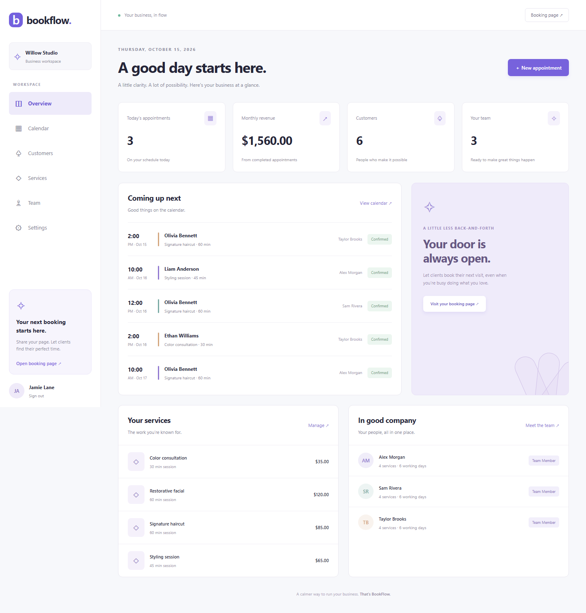

# BookFlow

A responsive appointment and customer management workspace for small service businesses. English product interface; fictional demo data.

**Live portfolio demo:** [Open BookFlow](https://bookflow-demo-c0g0.onrender.com) · [Public booking](https://bookflow-demo-c0g0.onrender.com/book/willow-studio). Personal demonstration project with fictional data, hosted on Render Free + Neon Free. Verified over real HTTPS: 45 local automated tests, 36 public API checks and 17 browser checks. Password recovery/SMTP are disabled; four high dependency alerts remain documented. See [PUBLIC_DEPLOYMENT_REPORT.md](PUBLIC_DEPLOYMENT_REPORT.md), [SECURITY_NOTES.md](SECURITY_NOTES.md), [CASE_STUDY.md](CASE_STUDY.md), and [bilingual portfolio copy](PORTFOLIO_DESCRIPTION.md).



## Quick start (Windows PowerShell)

Requirements: Node.js 22.12+ and PostgreSQL binaries (`initdb`, `pg_ctl`, `psql`, `createdb`) on PATH.

```powershell
cd 'C:\Users\titiv\Documents\proyectos reales\BookFlow'
npm ci
npm run db:start
npm run db:generate
npm run db:migrate
npm run db:seed
npm run dev
```

Open http://127.0.0.1:5173. API: http://127.0.0.1:3001/api/health.

The database script creates a separate localhost-only PostgreSQL cluster on port 55432, with a randomly generated password stored in ignored `.env`. It does not modify existing PostgreSQL services. Stop it with `npm run db:stop`.

Demo account: `demo@bookflow.example` / `BookFlowDemo!2026`.
Public page: http://127.0.0.1:5173/book/willow-studio.
Demo credentials are public fixtures; never seed this account into a real customer deployment.

## Features

- Registration, sign-in, opaque cookie sessions, sign-out, password recovery.
- Dashboard with daily counts and completed monthly revenue.
- Daily, weekly, monthly calendar; booking, rescheduling, statuses and notes.
- Customer directory and visit history; services and prices; staff management.
- Staff service assignments, weekly working hours and time off.
- Public booking with server-side conflict and availability validation.
- Business timezone/currency settings and appointment audit history.
- Tenant-scoped operations, relational tenant constraints, transactional staff locks, database overlap exclusion, booking idempotency.

## Password recovery

With PASSWORD_RESET_MODE=local in development, reset messages are written to `.local/outbox/`. These sensitive links are ignored by Git. The public demo uses PASSWORD_RESET_MODE=disabled: recovery returns 503 without writing tokens or sending mail. Production never allows local outbox mode. SMTP mode requires explicit SMTP_URL/MAIL_FROM and separate authorization; no real SMTP is configured.

## Verification

```powershell
npm run typecheck
npm run lint
npm test
npm run build
npm run verify:start
npm run verify:production
npx playwright install chromium
npm run test:e2e
```

See TESTING.md for actual results and limitations, ARCHITECTURE.md for invariants, and DEPLOYMENT.md for deployment instructions. No production deployment was performed.

After building, `npm start` runs the compiled API on port 3001. In development mode the frontend is served by Vite (`npm run dev`); production mode serves dist and requires the environment in DEPLOYMENT.md. `npm run verify:start` checks the compiled API on port 3002 with a real database health query.

## Portfolio assets

Run `npm run screenshots` with the local development servers available. The six captures in [docs/screenshots](docs/screenshots/README.md) show dashboard, calendar, customers, team, public booking and mobile. They contain only Willow Studio fixtures. Never run this capture script against a real business workspace.

For a release, stage the intended source files and run `npm run verify:repository` before committing. It checks ignored sensitive paths, common credential patterns and accidental inclusion of the actual local database password. It is a focused safety check, not a comprehensive secrets scanner.

## Known limits

This release has one owner permission level, process-local rate limiting, unpaginated workspace fetching and no real SMTP delivery verification. Currency changes relabel values without converting historical amounts. Ambiguous autumn DST times use Luxon's offset choice. The public page validates a manually selected time; it does not list available slots. Audit entries record actual actions, not before/after snapshots. Local PostgreSQL uses a development superuser; hosting requires restricted roles.
